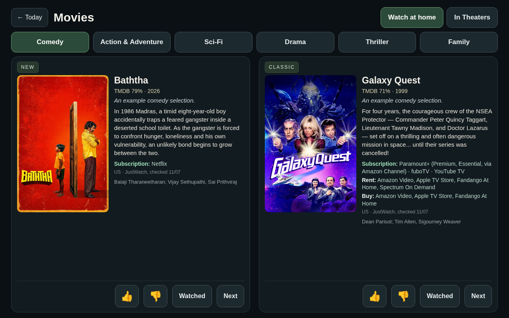
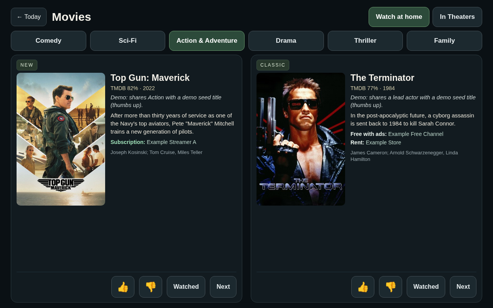
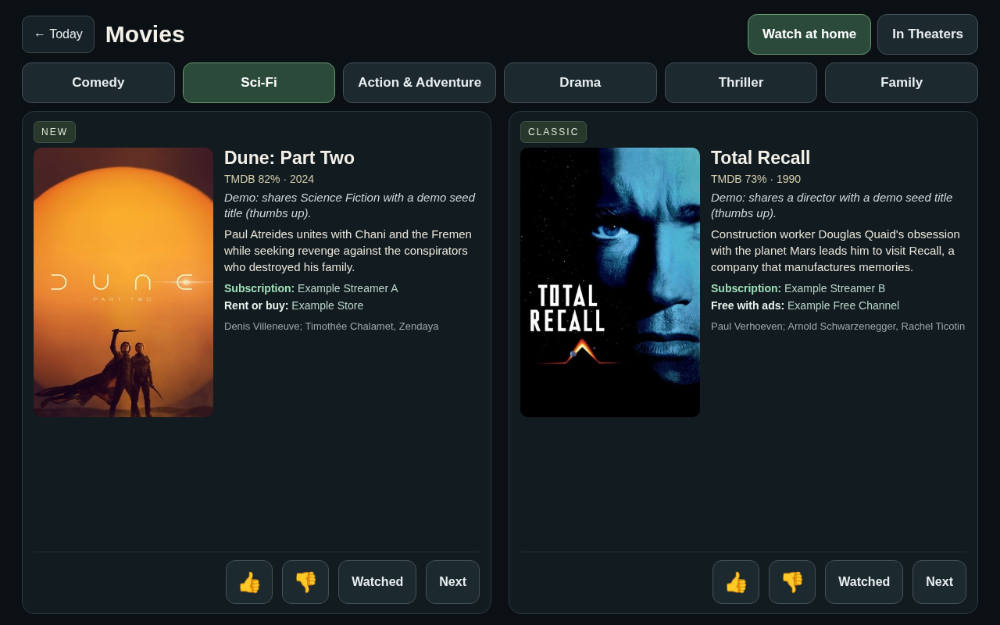
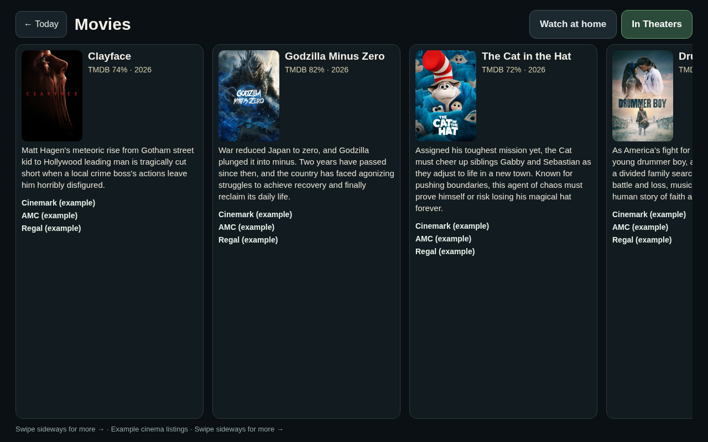

# MovieBot

MovieBot is a **single-person** AI movie recommendation agent. One human instance owns taste, subscriptions, and the recommendation pipeline. It is designed to stay private until you choose to publish; this repository is the reusable MIT-licensed core.

A [photo-frame dashboard](https://github.com/jcandillo/photo-frame-dashboard-android) integration is **optional**. MovieBot runs fully without any frame hardware or that Android project. The two projects are separate and both benefit when you wire them together.

## What it does (core)

- Curates **New** and **Classic** movie recommendations for at-home streaming
- Organizes picks by genre: Comedy, Action & Adventure, Sci-Fi, Drama, Thriller, Family
- Requires a spoiler-free description (TMDB overview, ≤280 characters) and **where to watch** (US region, provider, subscription vs rent/buy, or an explicit unavailable/unverified status) on every streaming recommendation
- Can build an **In Theaters** list for the configured home area: titles, descriptions and the names of **first-rate** theaters you choose (discount/second-rate excluded) — **no showtimes** (useful on its own or with a frame display)
- Applies thumbs / Watched / Next feedback before regenerating the next plan

## Single-human instance

Each deployment is for one person. Taste signals, watch history, subscription list, home area, and theater branches live in local config and local databases — never in this repo. Skills describe procedures; they do not embed personal profiles.

## Start here

- **Agents:** read [`docs/REPLICATE.md`](docs/REPLICATE.md) (the build spec) and [`docs/architecture.md`](docs/architecture.md). §18 of REPLICATE lists what this repo implements vs what is spec-only.
- **Recommendation quality:** the optional reco layer (impression/reaction logging, quality floor, wider TMDB pool, MovieLens collaborative similarity, personal model, exploration, offline eval) is described in [`docs/reco.md`](docs/reco.md).
- **Humans:** the public overview is at <https://sites.google.com/view/moviebot>.

## Quickstart (core, no display needed)

Requirements: Python 3.10+ (standard library only), `sqlite3` CLI optional.

```bash
git clone https://github.com/jcandillo/moviebot.git && cd moviebot

# 1. Private config (gitignored). Your agent fills "onboarding" during taste-only onboarding.
cp config/local.example.json config/local.json
cp .env.example .env            # optional for local runs; prefer your host's secret entry

# 2. TMDB key: create your own (docs/tmdb-api-key-setup.md) and store it as TMDB_API_KEY
#    in your host's secure secret entry. Never paste it into chat, git or skills.

# 3. Create the personal store
python3 -c "import sqlite3; sqlite3.connect('moviebot.db').executescript(open('docs/schema.sql').read())"

# 4. Run the tests
for t in tests/test_*.py theaters/test_titles_only_shape.py; do python3 "$t"; done

# 5. Feedback -> regenerate -> plan -> where-to-watch (see docs/pipeline.md)
python3 pipeline/feedback_apply.py run --help      # then run with --moviebot-db ./moviebot.db ...
python3 theaters/local_showtimes.py build --out /tmp/in_theaters.json   # optional In Theaters
```

Then load the `skills/moviebot-*` collection into your agent so its procedures match this repo, and keep a private instance copy of `docs/architecture.md` for your own locked decisions (do not publish personal links).

## Single-human instance

Each deployment is for one person. Taste signals, onboarding answers, watch history, subscription list, home area and theater choices live in `config/local.json` and local databases — never in this repo. Skills describe procedures; they do not embed personal profiles.

## Where-to-watch: spec vs reference implementation

- **Spec path:** TMDB `movie/{id}/watch/providers` (region-specific, with TMDB/JustWatch attribution), using your own TMDB key.
- **Reference implementation today:** `pipeline/where_to_watch.py` parses public JustWatch US title pages and `pipeline/feedback_apply.py` reads public TMDB web pages for metadata. Both are stopgaps that need no key; check the providers' terms before relying on them, and prefer the API path. Unknown always stays `unverified`; offers, prices and links are never invented.

## Optional: photo-frame dashboard integration

MovieBot and the [photo-frame dashboard](https://github.com/jcandillo/photo-frame-dashboard-android) are **two different projects**. Neither depends on the other to run. If you have a frame display, the optional package under `integrations/photo-frame/` adds:

- Kiosk HTML for genre buttons (New/Classic), where-to-watch lines, descriptions, and an In Theaters view (titles + theater names, no showtimes). Rent/Buy and Unsubscribed views are specified but not yet implemented
- HTTPS frame server and CAS `publish-picks.py` helper
- Wake script that prepares an enriched plan for the frame host
- Frame-specific agent skill

Example frame views (demo data; layout only, not current availability or anyone's taste):



*Comedy: New and Classic*



*Action & Adventure: New and Classic*



*Sci-Fi: descriptions and where to watch*



*In Theaters: example national chains, no showtimes*

See [`integrations/photo-frame/README.md`](integrations/photo-frame/README.md). Core MovieBot code never imports that package.

## Repository layout

```
config/                      # local.example.json (demo placeholders); local.json is gitignored
docs/                        # REPLICATE.md (spec), architecture.md, schema.sql, runbooks
pipeline/                    # core intake, feedback, lease, where-to-watch, genre schema
theaters/                    # optional local showtimes builder (titles-only JSON)
skills/                      # core moviebot-* agent skills
tools/                       # pool/build helpers
tests/                       # synthetic fixtures + unit checks
integrations/photo-frame/    # OPTIONAL frame dashboard bridge (not required to run MovieBot)
```

## Privacy

This public-ready tree must not contain real names, home cities, street addresses, specific theater branches, emails, phones, hostnames, personal watch history, or secrets. If you fork for your own home, keep `config/local.json`, databases, and picks out of git.

## License

MIT — see [LICENSE](LICENSE). Copyright (c) 2026 MovieBot contributors.
