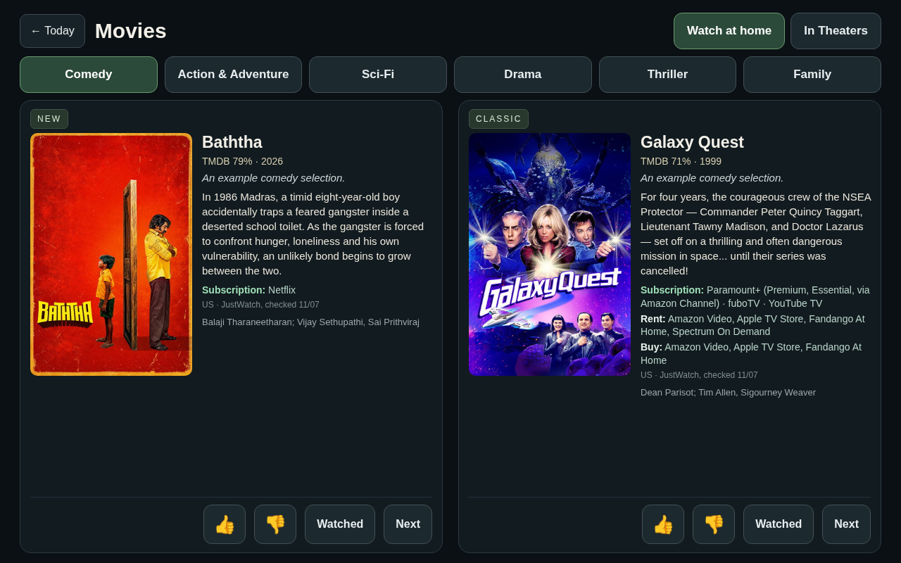
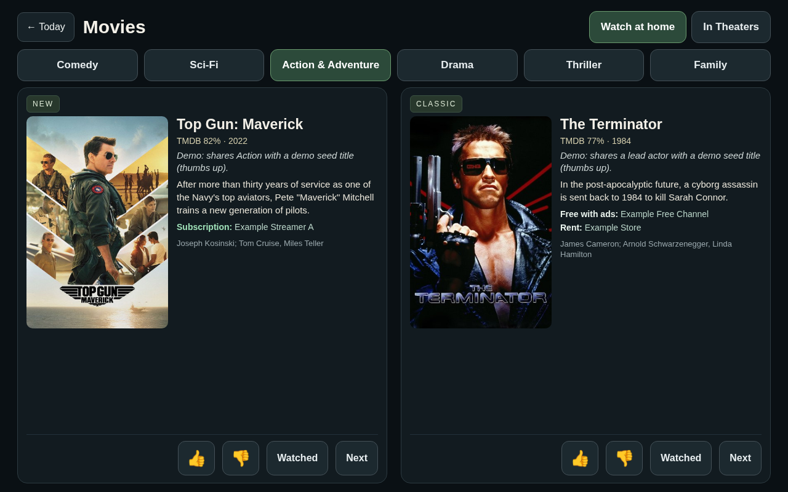
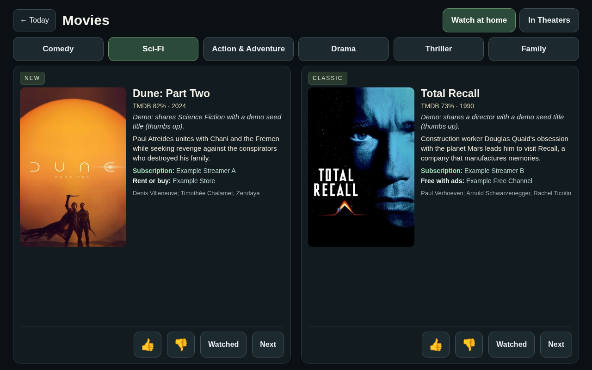
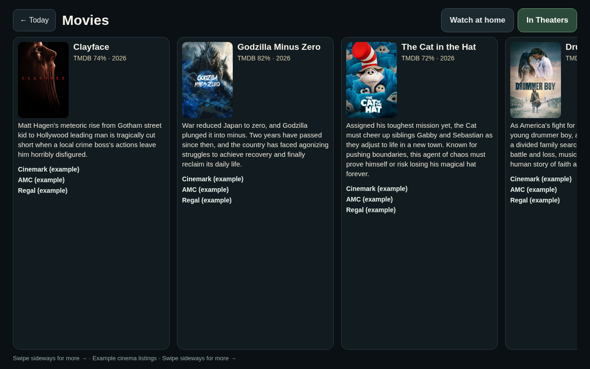

# Optional: photo-frame dashboard integration

This package is **not required** to run MovieBot.

MovieBot (this repository) and the [photo-frame dashboard](https://github.com/jcandillo/photo-frame-dashboard-android) are separate projects. Use this folder only when you want MovieBot recommendations to appear on a frame display that already runs that dashboard (or a compatible kiosk). The photo-frame dashboard repository does not contain the movies page; it lives here.

## What you get

- `index.html` — movies page: Watch at Home genre buttons (New/Classic) with descriptions and where-to-watch, plus a separate In Theaters view (titles and theater names only; no showtimes)
- `https_server.py` / `server.py` — local display HTTP(S) helpers (vote/action endpoints, staging server)
- `publish-picks.py` — compare-and-swap publisher for `picks.json` on the display host (imports the genre schema from core `pipeline/genre_cards.py`)
- `wake_pipeline.sh` — optional orchestrator that calls core pipeline modules, then stops before publish
- `skills/moviebot-frame-movie-night/` — agent skill for display publish/verify workflows

## Setup sketch

1. Run MovieBot core on its own first (TMDB secret, local DB, recommendations). See the root README quickstart.
2. Install or already run [photo-frame-dashboard-android](https://github.com/jcandillo/photo-frame-dashboard-android) (or your own kiosk host).
3. Copy or serve files from this folder on the display host. Keep wake credentials in your host's secure secret entry or a gitignored `wake-webhook.env` that the owner fills in themselves.
4. Point `publish-picks.py` at the host's picks paths; use `set-theaters` / `replace` only under the workflow lease and compare-and-swap rules.
5. Load `skills/moviebot-frame-movie-night/SKILL.md` into the agent that owns the publish step.
6. Optional: put owner-reported services in the picks doc as `reported_subscriptions` (e.g. `["Example Streamer A"]`) so they are listed first. This is display ordering only, never an entitlement claim.

Core packages under `pipeline/` and `theaters/` must not import anything from this directory (`tests/test_core_isolation.py`).

## Views: implemented vs specified

| View | Status in this repo | Rules |
|---|---|---|
| Watch at Home (six genres × New/Classic) | **Implemented** (`index.html`) | Subscription/free only, gated on fresh `verified_active` subscription evidence (or free/AVOD). |
| In Theaters | **Implemented** (`index.html`, `theaters/local_showtimes.py`) | Any first-rate theater; exclude discount/second-rate. No showtimes. Public examples chain-only. |
| Rent/Buy | **Spec-only** | Read-only rent/buy-only titles; no prices or transaction controls. |
| Unsubscribed | **Spec-only** | Top 10 per unsubscribed service; YouTube TV excluded; "not subscribed" once the owner confirms. |

## Subscription-aware home gate
- Watch at Home is eligible only with a US free/AVOD offer, or a US flatrate offer on a service in the owner's fresh `verified_active` subscription records (verified tier; bundle/channel aliases mapped).
- `likely_active` and `unknown` never qualify. Provider availability, connector reachability and library lists are not proof of payment.
- No qualifying offer: Rent/Buy if paid options exist, else hold. Never say "your X" for an unverified service.
- An explicit, dated owner confirmation is a valid `verified_active` source (source=human). A passed renewal date with no fresh evidence becomes `unknown`, never inactive. No account or billing changes.
- A home title that also has rent/buy shows its qualifying streaming provider, with paid alternatives on a separate line.

## Rent/Buy view (spec)
- Read-only. Each card shows the TMDB description, rent/buy providers and a dated "checked" line. No prices, votes, Watched/Next, sign-up links or transaction controls.
- Spec-only publisher step (not yet in this repo's `publish-picks.py`): `migrate-rent-buy --expected-revision N --spec FILE` makes one guarded compare-and-swap, replaces each listed genre card (guarded by its expected outgoing tmdb_id), writes `rent_buy {status, checked_at, note, items[]}`, and is idempotent on `migration_id`.
- Known limitation of the design: Rent/Buy is not auto-refreshed. An update that would leave an ineligible home title is rejected for explicit repair; never claim re-verification that did not happen.

## Unsubscribed view (spec)
- One sub-tab per major US streaming service the owner does not have as `verified_active`. Live-TV bundles such as **YouTube TV are excluded**.
- Each sub-tab shows the **top 10** taste-matched movies on that service's flatrate offer, as standard cards (description, provider, dated check).
- Unknown status is labeled "not confirmed"; once the owner explicitly confirms they don't subscribe, label it **"not subscribed"**.
- Read-only: no prices, sign-up links or transaction controls; never implies the owner has the service; never counts toward Watch at Home. Hide empty sub-tabs.
- Precedence: a title also on a `verified_active` subscription or free belongs to Watch at Home (if picked) and is excluded from every Unsubscribed sub-tab. A rentable title that also streams on an unsubscribed service may appear in both Rent/Buy and Unsubscribed, with both access types labeled.
- Configure via `config/local.json` → `unsubscribed` (`top_n_per_service`, `excluded_services`, `confirmed_not_subscribed`).

## Example views

Offline renders of `index.html` with **demo data** (demo taste seeds, example service names). They illustrate layout only; they are not a live feed, not anyone's taste, and not current availability. Theater labels are national chains marked "(example)". Re-render with `integrations/photo-frame/tools/render_demo_screens.py`.

